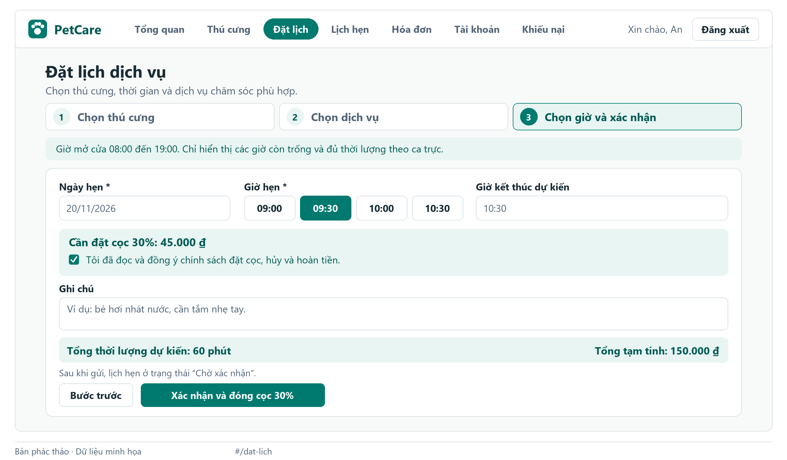
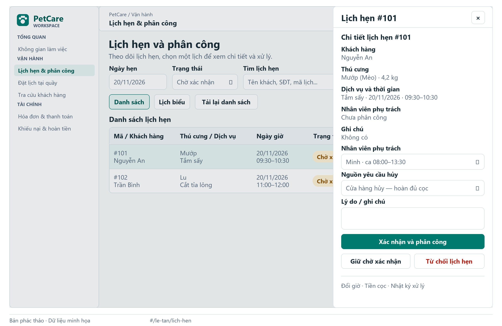
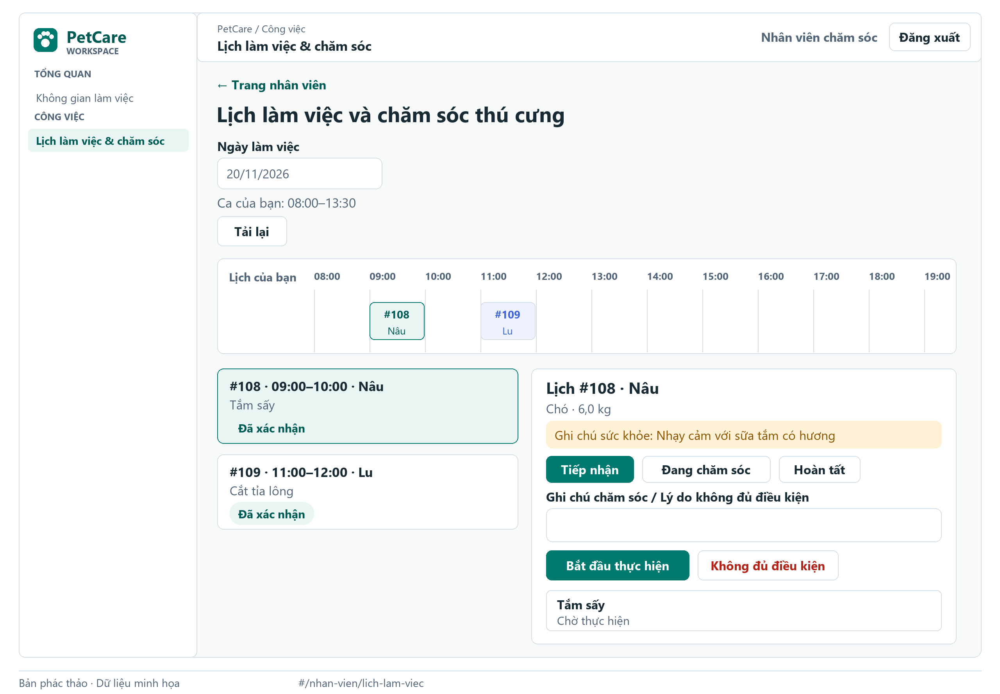
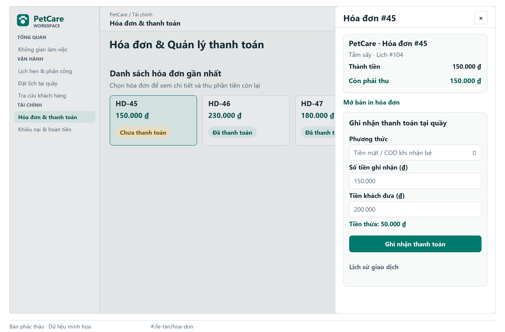
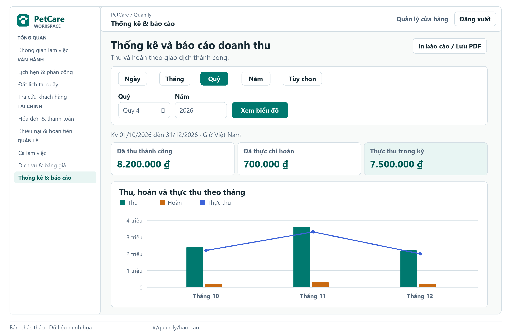
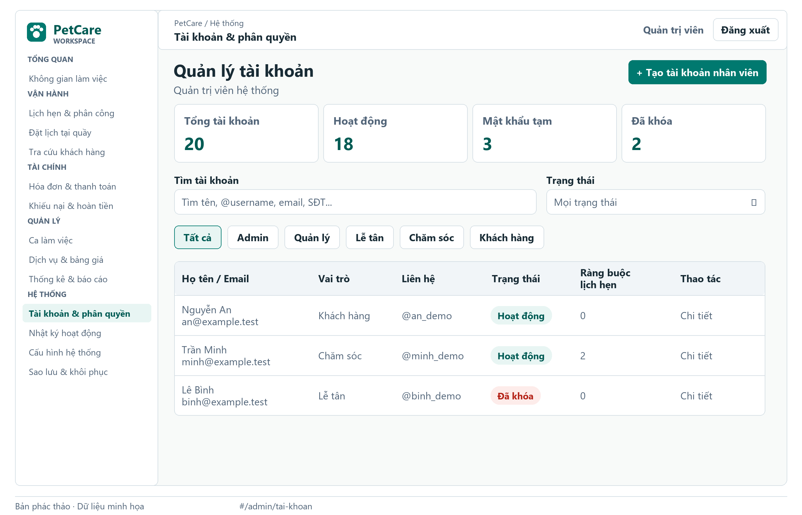

# PHỤ LỤC

## Phụ lục A. Truy vết yêu cầu, giao diện và API

Bảng này bổ sung cho Bảng 2.2, 2.5 và 2.10. Đường dẫn màn hình nằm sau dấu `#` trong ứng dụng. Các cột chỉ liệt kê những tuyến tiêu biểu của từng nghiệp vụ.

| Nghiệp vụ | Màn hình | API tiêu biểu | Điều kiện xử lý |
|---|---|---|---|
| Đặt lịch trực tuyến | `/dat-lich` | `GET /api/lich-hen/khung-gio-trong`, `POST /api/lich-hen` | Khách đặt cho thú cưng thuộc hồ sơ của mình. Server kiểm tra lại khung giờ khi tạo lịch. |
| Tiếp nhận tại quầy | `/le-tan/dat-lich-tai-quay` | `POST /api/lich-hen/tai-quay` | Lễ tân, quản lý hoặc Admin thao tác theo quyền. |
| Phân công và xử lý lịch | `/le-tan/lich-hen` | `GET /api/lich-hen/:id/nhan-vien-kha-dung`, `PATCH /api/lich-hen/:id/xu-ly` | Kiểm ca bao trọn khoảng hẹn và các lịch liên quan trước khi phân công. |
| Cập nhật chăm sóc | `/nhan-vien/lich-lam-viec` | `PATCH /api/lich-hen/:id/cham-soc` | Nhân viên chăm sóc chỉ cập nhật lịch được phân công theo trạng thái hợp lệ. |
| Lập hóa đơn và ghi thu | `/le-tan/hoa-don` | `POST /api/hoa-don`, `POST /api/hoa-don/:id/thanh-toan` | Lập hóa đơn cho lịch đủ điều kiện. Số tiền ghi thu được kiểm tra với số còn phải trả. |
| Duyệt và chi hoàn | `/le-tan/khieu-nai` | `PATCH /api/khieu-nai/:id/quyet-dinh`, `POST /api/khieu-nai/:id/chi-hoan` | Duyệt hoàn thuộc quản lý hoặc Admin. Kết quả thực chi được ghi nhận ở bước riêng. |
| Xem báo cáo doanh thu | `/quan-ly/bao-cao` | `GET /api/bao-cao/doanh-thu` | Quản lý hoặc Admin chọn kỳ để xem thu, hoàn và thực thu. |
| Quản lý tài khoản | `/admin/tai-khoan` | `GET /api/admin/tai-khoan`, `PATCH /api/admin/tai-khoan/:id` | API giới hạn cho Admin. Các thao tác khóa, mở khóa và đặt lại mật khẩu có tuyến riêng. |

*Nguồn: tác giả đối chiếu `App.jsx`, `staffNavigation.js` và các tệp tuyến trong `backend/src/routes`.*

## Phụ lục B. Lược đồ, ràng buộc và các phiên bản cơ sở dữ liệu

| Phiên bản | Tài liệu lược đồ | Thay đổi liên quan đến báo cáo |
|---|---|---|
| 000 | `thu_cung.sql` | Tài khoản, hồ sơ, thú cưng, danh mục, lịch hẹn, đánh giá, hóa đơn và giao dịch nền. |
| 001–003 | `migrations/001_schema_improvements.sql` đến `003_shifts_and_care.sql` | Ca làm việc, khiếu nại, thông báo, phiên xác thực, nhật ký lịch hẹn và ràng buộc giao thoa. |
| 004–005 | `migrations/004_finance.sql`, `005_complaints_refunds.sql` | Thông tin ghi thu, khóa chống lặp, trạng thái hoàn, tách quyết định hoàn và thực chi. |
| 006–007 | `migrations/006_payment_sandbox.sql`, `007_booking_deposits.sql` | Ý định thanh toán sandbox, cọc theo lịch, giao dịch cọc và quy tắc hủy, đổi lịch. |
| 008 | `migrations/008_password_reset.sql` | Lưu token đặt lại mật khẩu dưới dạng băm và theo dõi thời hạn, thời điểm sử dụng. |

Khi xem Bảng 2.8–2.9, cần đọc DDL gốc cùng các migration theo thứ tự. Khóa ngoại duy trì quan hệ tham chiếu, còn kiểm tra ca bao trọn và công suất của lịch chờ được thực hiện trong lớp nghiệp vụ. Ràng buộc loại trừ khoảng thời gian hỗ trợ chặn giao thoa trong phạm vi các bản ghi mà điều kiện ràng buộc áp dụng.

*Nguồn: tác giả đối chiếu `thu_cung.sql`, các migration 001–008 và hồ sơ thiết kế cơ sở dữ liệu.*

## Phụ lục C. Ca kiểm thử và mốc đối chiếu

| Tình huống | Điều kiện kiểm tra hoặc kết quả kỳ vọng | Tệp kiểm thử |
|---|---|---|
| Hai ca tiếp giáp cùng một nhân viên | Lịch vượt qua điểm giao ca bị loại khi từng ca riêng lẻ đều không bao trọn khoảng hẹn. | `backend/test/scheduling.test.js` |
| Lịch kết thúc đúng lúc lịch khác bắt đầu | Hai khoảng tiếp giáp được xét tuần tự nếu các điều kiện khác thỏa mãn. | `backend/test/scheduling.test.js` |
| Vượt giới hạn tìm kiếm công suất | Dừng kiểm tra và báo tạm thời chưa xử lý được qua lỗi `503`. | `backend/test/scheduling.test.js` |
| Tài khoản ngoài nhóm điều phối | API xem ứng viên hoặc xử lý lịch từ chối tài khoản ngoài nhóm được cấp quyền. | `backend/test/dispatch.integration.test.js` |
| Tạo hoặc tải lại thông tin QR | Giá trị do server tính. Tạo hoặc tải lại hướng dẫn thanh toán chưa ghi tiền vào giao dịch. | `backend/test/payment-transfers.integration.test.js` |
| Xác nhận khoản chuyển khoản nhiều lần | Lần ghi thu được xử lý trong giao dịch và kiểm tra khóa chống lặp. | `backend/test/payment-transfers.integration.test.js` |

Các dòng trên nêu tiêu chí từ ca thử trong mã. Kết quả đã thực thi được đọc theo từng đợt ở Bảng 3.5 và các biên bản sau.

- [Báo cáo kiểm thử hệ thống](../../plans/BAO_CAO_KIEM_THU_HE_THONG.md) ghi lượt lõi ngày 23–24/10/2026. Lượt trên cơ sở dữ liệu cô lập ghi 83 PASS theo quy ước đếm của biên bản.
- [Biên bản chuyển khoản](../THANH_TOAN_CHUYEN_KHOAN.md) ghi bốn nhóm tích hợp trên các cơ sở dữ liệu thử riêng ngày 25/10/2026, tổng 38 PASS trong phạm vi đợt đó.
- [Báo cáo sắp xếp thư mục](../../plans/BAO_CAO_SAP_XEP_THU_MUC.md) ghi lượt backend mặc định ngày 07/11/2026 gồm 83 PASS và 13 nhóm tích hợp SKIP. Những nhóm SKIP chưa được thực thi trong lượt này.

## Phụ lục D. Phác thảo màn hình và ghi chú đối chiếu UML

Các hình dưới đây được dựng theo bố cục và nhãn điều khiển của giao diện Web. Tên, thời gian và số liệu trên hình là dữ liệu minh họa thiết kế.

**Hình D.1. Đặt lịch dịch vụ ở bước chọn giờ và xác nhận**

**Hình D.2. Danh sách lịch hẹn và ngăn phân công nhân viên**

**Hình D.3. Lịch làm việc và chi tiết tiếp nhận chăm sóc**

**Hình D.4. Hóa đơn và ghi nhận tiền mặt tại quầy**

**Hình D.5. Chọn kỳ và xem biểu đồ thu, hoàn, thực thu**

**Hình D.6. Tổng quan, bộ lọc và danh sách tài khoản**

*Nguồn Hình D.1–D.6: tác giả phác thảo dựa trên bố cục React của các màn hình tương ứng.*

Khi đọc các sơ đồ UML trong Chương 2, lưu ý ba sai khác giữa thiết kế ban đầu và mã cài đặt.

- **Đặt lịch.** Mã kiểm tra khả thi trên toàn khoảng và tập nhân viên đủ ca. Phép đếm số lịch và số người trực trong sơ đồ tuần tự ban đầu diễn tả mức khái quát của quy trình.
- **Điều phối.** Thao tác giữ chờ, từ chối và phân công là các lựa chọn riêng. Trạng thái từ chối (`TuChoi`) được lưu riêng với trạng thái hủy (`DaHuy`).
- **Hoàn tiền.** Duyệt hoàn chuyển khiếu nại sang chờ hoàn. Dữ liệu tiền hoàn cập nhật sau khi thực chi thành công.
