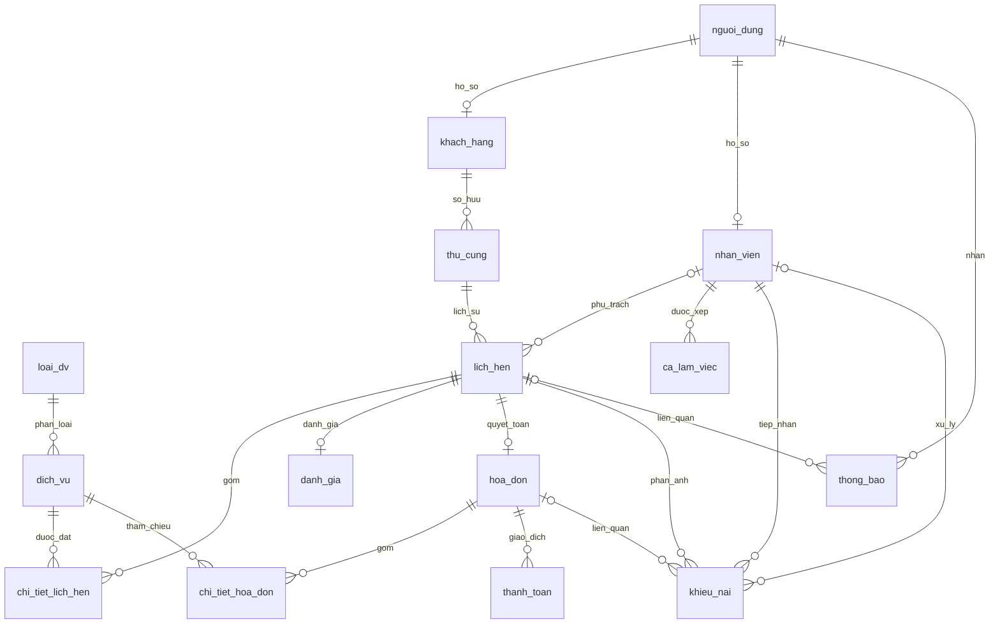

# THIẾT KẾ CƠ SỞ DỮ LIỆU PETCARE - ĐỐI CHIẾU SCHEMA THỰC TẾ

> Phiên bản 2.0 - ngày 23/10/2026. Đồng hành với ke_hoach_tong_the.md phiên bản 2.0.
> Mô tả SQL trong repo sau khi áp dụng thu_cung.sql rồi migrations/001_schema_improvements.sql. Chưa xác nhận migration đã chạy trên DB đang dùng.
> Không chạy SQL hoặc thay đổi dữ liệu trong lần cập nhật tài liệu này.

## 1. Quyết định thiết kế và phạm vi

- Giữ PostgreSQL và pg; không đổi ORM hoặc thay toàn bộ schema đang dùng chỉ để giống tài liệu cũ.
- Schema gốc có 12 bảng; migration thêm ca_lam_viec, khieu_nai, thong_bao: tổng 15 bảng.
- Khóa chính chủ yếu INTEGER GENERATED ALWAYS AS IDENTITY; khach_hang/nhan_vien dùng PK đồng thời FK sang nguoi_dung. Không dùng UUID/pgcrypto ở schema hiện tại.
- Dữ liệu hồ sơ khách và nhân viên tách bảng; không có ho_ten/chuc_vu trực tiếp trong nguoi_dung. Admin có thể chỉ có tài khoản nguoi_dung.
- Khách của lịch suy ra qua thú cưng; thời gian lịch lưu TIMESTAMP bắt đầu/kết thúc, không phải ba cột ngày/giờ tách riêng.
- BOOLEAN cho hoạt động tài khoản/thú cưng/dịch vụ; VARCHAR kết hợp CHECK cho trạng thái nghiệp vụ. Không mô tả là PostgreSQL ENUM khi chưa có CREATE TYPE.
- Bản trước có mô hình 12 bảng, UUID và tên cột khác; bản này thay bằng schema đang được controllers truy vấn. Mọi bổ sung tương lai được tách riêng ở mục 7, chưa coi đã tồn tại.

## 2. Danh sách bảng

| STT | Bảng | Nguồn | Chức năng |
| --- | --- | --- | --- |
| 1 | `nguoi_dung` | Schema gốc | Tài khoản và thông tin liên hệ |
| 2 | `khach_hang` | Schema gốc | Hồ sơ khách hàng |
| 3 | `nhan_vien` | Schema gốc | Hồ sơ nhân viên và chức vụ |
| 4 | `thu_cung` | Schema gốc | Hồ sơ thú cưng |
| 5 | `loai_dv` | Schema gốc | Nhóm dịch vụ |
| 6 | `dich_vu` | Schema gốc | Danh mục/giá/thời lượng |
| 7 | `lich_hen` | Schema gốc | Lịch hẹn và nhân viên phụ trách |
| 8 | `chi_tiet_lich_hen` | Schema gốc | Dịch vụ được đặt và giá dự kiến |
| 9 | `danh_gia` | Schema gốc | Đánh giá theo lịch |
| 10 | `hoa_don` | Schema gốc | Hóa đơn quyết toán |
| 11 | `chi_tiet_hoa_don` | Schema gốc | Bản chụp dòng hóa đơn |
| 12 | `thanh_toan` | Schema gốc | Giao dịch thu/hoàn |
| 13 | `ca_lam_viec` | Migration 001 | Ca làm của nhân viên |
| 14 | `khieu_nai` | Migration 001 | Tiếp nhận và kết quả phản ánh |
| 15 | `thong_bao` | Migration 001 | Thông báo trong ứng dụng |

## 3. ERD và quan hệ



Bội số 0..n của bảng chi tiết phản ánh khả năng của schema; ứng dụng phải tạo ít nhất một dòng khi lập lịch/hóa đơn. Không coi bội số 1..* trong lớp miền là sai chỉ vì FK cho phép 0 dòng tạm thời. ERD mô tả lưu trữ; sơ đồ lớp miền vẫn có thể dùng kế thừa KhachHang/NhanVien từ NguoiDung.

## 4. Từ điển đủ cột sau migration

Quy ước: PK khóa chính; FK khóa ngoại; UK duy nhất đơn cột; NULL được để trống. Chuỗi ràng buộc lấy từ khai báo cột; CHECK nhiều dòng và ràng buộc tổ hợp được giải thích ở mục 5 và SQL nguồn. Cột DEFAULT NOW() không đồng nghĩa tự động cập nhật ở mọi UPDATE.

### 4.1. `nguoi_dung` - Tài khoản và thông tin liên hệ

| Cột | Kiểu | Khóa | NULL | Ràng buộc / tham chiếu / mặc định ở khai báo cột |
| --- | --- | --- | --- | --- |
| `ma_nguoi_dung` | `INTEGER` | PK | Không | `GENERATED ALWAYS AS IDENTITY PRIMARY KEY` |
| `ten_dang_nhap` | `VARCHAR(50)` | UK | Không | `NOT NULL UNIQUE` |
| `mat_khau_hash` | `VARCHAR(255)` | - | Không | `NOT NULL` |
| `email` | `VARCHAR(100)` | UK | Có | `UNIQUE` |
| `so_dien_thoai` | `VARCHAR(15)` | UK | Có | `UNIQUE` |
| `vai_tro` | `VARCHAR(20)` | - | Không | `NOT NULL` |
| `trang_thai` | `BOOLEAN` | - | Không | `NOT NULL DEFAULT TRUE` |
| `ngay_tao` | `TIMESTAMP` | - | Không | `NOT NULL DEFAULT NOW()` |
| `ngay_cap_nhat` | `TIMESTAMP` | - | Không | `NOT NULL DEFAULT NOW()` |

### 4.2. `khach_hang` - Hồ sơ khách hàng

| Cột | Kiểu | Khóa | NULL | Ràng buộc / tham chiếu / mặc định ở khai báo cột |
| --- | --- | --- | --- | --- |
| `ma_khach_hang` | `INTEGER` | PK/FK | Không | `PRIMARY KEY REFERENCES nguoi_dung(ma_nguoi_dung)` |
| `ho_ten` | `VARCHAR(100)` | - | Không | `NOT NULL` |
| `dia_chi` | `VARCHAR(255)` | - | Có | - |
| `ghi_chu` | `VARCHAR(500)` | - | Có | - |
| `ngay_cap_nhat` | `TIMESTAMP` | - | Không | `NOT NULL DEFAULT NOW()` |

### 4.3. `nhan_vien` - Hồ sơ nhân viên và chức vụ

| Cột | Kiểu | Khóa | NULL | Ràng buộc / tham chiếu / mặc định ở khai báo cột |
| --- | --- | --- | --- | --- |
| `ma_nhan_vien` | `INTEGER` | PK/FK | Không | `PRIMARY KEY REFERENCES nguoi_dung(ma_nguoi_dung)` |
| `ho_ten` | `VARCHAR(100)` | - | Không | `NOT NULL` |
| `chuc_vu` | `VARCHAR(50)` | - | Không | `NOT NULL` |
| `chuyen_mon` | `VARCHAR(100)` | - | Có | - |
| `ngay_vao_lam` | `DATE` | - | Có | - |
| `trang_thai` | `BOOLEAN` | - | Không | `NOT NULL DEFAULT TRUE` |
| `ngay_cap_nhat` | `TIMESTAMP` | - | Không | `NOT NULL DEFAULT NOW()` |

### 4.4. `thu_cung` - Hồ sơ thú cưng

| Cột | Kiểu | Khóa | NULL | Ràng buộc / tham chiếu / mặc định ở khai báo cột |
| --- | --- | --- | --- | --- |
| `ma_thu_cung` | `INTEGER` | PK | Không | `GENERATED ALWAYS AS IDENTITY PRIMARY KEY` |
| `ma_khach_hang` | `INTEGER` | FK | Không | `NOT NULL REFERENCES khach_hang(ma_khach_hang)` |
| `ten_thu_cung` | `VARCHAR(50)` | - | Không | `NOT NULL` |
| `loai_thu_cung` | `VARCHAR(10)` | - | Không | `NOT NULL CHECK (loai_thu_cung IN ('Chó','Mèo'))` |
| `giong` | `VARCHAR(50)` | - | Có | - |
| `gioi_tinh` | `VARCHAR(10)` | - | Có | `CHECK (gioi_tinh IN ('Đực','Cái'))` |
| `ngay_sinh` | `DATE` | - | Có | - |
| `can_nang` | `NUMERIC(5,2)` | - | Có | `CHECK (can_nang > 0)` |
| `ghi_chu_suc_khoe` | `VARCHAR(500)` | - | Có | - |
| `trang_thai` | `BOOLEAN` | - | Không | `NOT NULL DEFAULT TRUE` |
| `ngay_tao` | `TIMESTAMP` | - | Không | `NOT NULL DEFAULT NOW()` |
| `ngay_cap_nhat` | `TIMESTAMP` | - | Không | `NOT NULL DEFAULT NOW()` |
| `ngay_vaccine_gan_nhat` | `DATE` | - | Có | - |

### 4.5. `loai_dv` - Nhóm dịch vụ

| Cột | Kiểu | Khóa | NULL | Ràng buộc / tham chiếu / mặc định ở khai báo cột |
| --- | --- | --- | --- | --- |
| `ma_loai_dv` | `INTEGER` | PK | Không | `GENERATED ALWAYS AS IDENTITY PRIMARY KEY` |
| `ten_loai_dv` | `VARCHAR(100)` | UK | Không | `NOT NULL UNIQUE` |
| `mo_ta` | `VARCHAR(255)` | - | Có | - |

### 4.6. `dich_vu` - Danh mục/giá/thời lượng

| Cột | Kiểu | Khóa | NULL | Ràng buộc / tham chiếu / mặc định ở khai báo cột |
| --- | --- | --- | --- | --- |
| `ma_dv` | `INTEGER` | PK | Không | `GENERATED ALWAYS AS IDENTITY PRIMARY KEY` |
| `ma_loai_dv` | `INTEGER` | FK | Không | `NOT NULL REFERENCES loai_dv(ma_loai_dv)` |
| `ten_dv` | `VARCHAR(100)` | - | Không | `NOT NULL` |
| `mo_ta` | `VARCHAR(500)` | - | Có | - |
| `gia_hien_hanh` | `NUMERIC(12,2)` | - | Không | `NOT NULL CHECK (gia_hien_hanh >= 0)` |
| `thoi_luong_phut` | `INTEGER` | - | Có | `CHECK (thoi_luong_phut > 0)` |
| `trang_thai` | `BOOLEAN` | - | Không | `NOT NULL DEFAULT TRUE` |
| `ngay_cap_nhat` | `TIMESTAMP` | - | Không | `NOT NULL DEFAULT NOW()` |

### 4.7. `lich_hen` - Lịch hẹn và nhân viên phụ trách

| Cột | Kiểu | Khóa | NULL | Ràng buộc / tham chiếu / mặc định ở khai báo cột |
| --- | --- | --- | --- | --- |
| `ma_lich_hen` | `INTEGER` | PK | Không | `GENERATED ALWAYS AS IDENTITY PRIMARY KEY` |
| `ma_thu_cung` | `INTEGER` | FK | Không | `NOT NULL REFERENCES thu_cung(ma_thu_cung)` |
| `ma_nhan_vien` | `INTEGER` | FK | Có | `REFERENCES nhan_vien(ma_nhan_vien)` |
| `ngay_gio_hen` | `TIMESTAMP` | - | Không | `NOT NULL` |
| `ngay_gio_ket_thuc_du_kien` | `TIMESTAMP` | - | Có | - |
| `trang_thai` | `VARCHAR(20)` | - | Không | `NOT NULL DEFAULT 'ChoXacNhan'` |
| `ghi_chu` | `VARCHAR(500)` | - | Có | - |
| `ngay_tao` | `TIMESTAMP` | - | Không | `NOT NULL DEFAULT NOW()` |
| `ngay_cap_nhat` | `TIMESTAMP` | - | Không | `NOT NULL DEFAULT NOW()` |

### 4.8. `chi_tiet_lich_hen` - Dịch vụ được đặt và giá dự kiến

| Cột | Kiểu | Khóa | NULL | Ràng buộc / tham chiếu / mặc định ở khai báo cột |
| --- | --- | --- | --- | --- |
| `ma_chi_tiet_lich_hen` | `INTEGER` | PK | Không | `GENERATED ALWAYS AS IDENTITY PRIMARY KEY` |
| `ma_lich_hen` | `INTEGER` | FK | Không | `NOT NULL REFERENCES lich_hen(ma_lich_hen) ON DELETE CASCADE` |
| `ma_dv` | `INTEGER` | FK | Không | `NOT NULL REFERENCES dich_vu(ma_dv)` |
| `so_luong` | `INTEGER` | - | Không | `NOT NULL DEFAULT 1 CHECK (so_luong > 0)` |
| `gia_du_kien` | `NUMERIC(12,2)` | - | Không | `NOT NULL CHECK (gia_du_kien >= 0)` |
| `trang_thai` | `VARCHAR(20)` | - | Không | `NOT NULL DEFAULT 'ChoThucHien'` |
| `ghi_chu_cham_soc` | `VARCHAR(500)` | - | Có | - |

### 4.9. `danh_gia` - Đánh giá theo lịch

| Cột | Kiểu | Khóa | NULL | Ràng buộc / tham chiếu / mặc định ở khai báo cột |
| --- | --- | --- | --- | --- |
| `ma_danh_gia` | `INTEGER` | PK | Không | `GENERATED ALWAYS AS IDENTITY PRIMARY KEY` |
| `ma_lich_hen` | `INTEGER` | FK/UK | Không | `NOT NULL UNIQUE REFERENCES lich_hen(ma_lich_hen)` |
| `so_sao` | `INTEGER` | - | Không | `NOT NULL CHECK (so_sao BETWEEN 1 AND 5)` |
| `nhan_xet` | `VARCHAR(500)` | - | Có | - |
| `ngay_danh_gia` | `TIMESTAMP` | - | Không | `NOT NULL DEFAULT NOW()` |

### 4.10. `hoa_don` - Hóa đơn quyết toán

| Cột | Kiểu | Khóa | NULL | Ràng buộc / tham chiếu / mặc định ở khai báo cột |
| --- | --- | --- | --- | --- |
| `ma_hoa_don` | `INTEGER` | PK | Không | `GENERATED ALWAYS AS IDENTITY PRIMARY KEY` |
| `ma_lich_hen` | `INTEGER` | FK/UK | Không | `NOT NULL UNIQUE REFERENCES lich_hen(ma_lich_hen)` |
| `ngay_lap` | `TIMESTAMP` | - | Không | `NOT NULL DEFAULT NOW()` |
| `tong_tien` | `NUMERIC(12,2)` | - | Không | `NOT NULL CHECK (tong_tien >= 0)` |
| `giam_gia` | `NUMERIC(12,2)` | - | Không | `NOT NULL DEFAULT 0 CHECK (giam_gia >= 0)` |
| `thanh_tien` | `NUMERIC(12,2)` | - | Không | `NOT NULL` |
| `trang_thai` | `VARCHAR(20)` | - | Không | `NOT NULL DEFAULT 'ChuaThanhToan'` |
| `ghi_chu` | `VARCHAR(255)` | - | Có | - |

### 4.11. `chi_tiet_hoa_don` - Bản chụp dòng hóa đơn

| Cột | Kiểu | Khóa | NULL | Ràng buộc / tham chiếu / mặc định ở khai báo cột |
| --- | --- | --- | --- | --- |
| `ma_chi_tiet_hoa_don` | `INTEGER` | PK | Không | `GENERATED ALWAYS AS IDENTITY PRIMARY KEY` |
| `ma_hoa_don` | `INTEGER` | FK | Không | `NOT NULL REFERENCES hoa_don(ma_hoa_don) ON DELETE CASCADE` |
| `ma_dv` | `INTEGER` | FK | Không | `NOT NULL REFERENCES dich_vu(ma_dv)` |
| `ten_dv_luu_lai` | `VARCHAR(100)` | - | Không | `NOT NULL` |
| `so_luong` | `INTEGER` | - | Không | `NOT NULL CHECK (so_luong > 0)` |
| `don_gia` | `NUMERIC(12,2)` | - | Không | `NOT NULL CHECK (don_gia >= 0)` |
| `thanh_tien` | `NUMERIC(12,2)` | - | Không | `NOT NULL` |

### 4.12. `thanh_toan` - Giao dịch thu/hoàn

| Cột | Kiểu | Khóa | NULL | Ràng buộc / tham chiếu / mặc định ở khai báo cột |
| --- | --- | --- | --- | --- |
| `ma_thanh_toan` | `INTEGER` | PK | Không | `GENERATED ALWAYS AS IDENTITY PRIMARY KEY` |
| `ma_hoa_don` | `INTEGER` | FK | Không | `NOT NULL REFERENCES hoa_don(ma_hoa_don)` |
| `phuong_thuc` | `VARCHAR(20)` | - | Không | `NOT NULL CHECK (phuong_thuc IN ('TienMat','ChuyenKhoanQR'))` |
| `so_tien` | `NUMERIC(12,2)` | - | Không | `NOT NULL CHECK (so_tien > 0)` |
| `ngay_thanh_toan` | `TIMESTAMP` | - | Không | `NOT NULL DEFAULT NOW()` |
| `ma_giao_dich` | `VARCHAR(100)` | - | Có | - |
| `trang_thai` | `VARCHAR(20)` | - | Không | `NOT NULL CHECK (trang_thai IN ('ThanhCong','ThatBai','HoanTien'))` |
| `ly_do_hoan_tien` | `VARCHAR(255)` | - | Có | - |

### 4.13. `ca_lam_viec` - Ca làm của nhân viên

| Cột | Kiểu | Khóa | NULL | Ràng buộc / tham chiếu / mặc định ở khai báo cột |
| --- | --- | --- | --- | --- |
| `ma_ca_lam_viec` | `INTEGER` | PK | Không | `GENERATED ALWAYS AS IDENTITY PRIMARY KEY` |
| `ma_nhan_vien` | `INTEGER` | FK | Không | `NOT NULL REFERENCES nhan_vien(ma_nhan_vien)` |
| `ngay` | `DATE` | - | Không | `NOT NULL` |
| `gio_bat_dau` | `TIME` | - | Không | `NOT NULL` |
| `gio_ket_thuc` | `TIME` | - | Không | `NOT NULL` |
| `vi_tri` | `VARCHAR(100)` | - | Có | - |
| `ghi_chu` | `VARCHAR(255)` | - | Có | - |
| `ngay_tao` | `TIMESTAMP` | - | Không | `NOT NULL DEFAULT NOW()` |

### 4.14. `khieu_nai` - Tiếp nhận và kết quả phản ánh

| Cột | Kiểu | Khóa | NULL | Ràng buộc / tham chiếu / mặc định ở khai báo cột |
| --- | --- | --- | --- | --- |
| `ma_khieu_nai` | `INTEGER` | PK | Không | `GENERATED ALWAYS AS IDENTITY PRIMARY KEY` |
| `ma_lich_hen` | `INTEGER` | FK | Không | `NOT NULL REFERENCES lich_hen(ma_lich_hen)` |
| `ma_hoa_don` | `INTEGER` | FK | Có | `REFERENCES hoa_don(ma_hoa_don)` |
| `noi_dung` | `TEXT` | - | Không | `NOT NULL` |
| `ket_qua_xu_ly` | `TEXT` | - | Có | - |
| `trang_thai` | `VARCHAR(20)` | - | Không | `NOT NULL DEFAULT 'DaTiepNhan'` |
| `nguoi_tiep_nhan` | `INTEGER` | FK | Không | `NOT NULL REFERENCES nhan_vien(ma_nhan_vien)` |
| `nguoi_xu_ly` | `INTEGER` | FK | Có | `REFERENCES nhan_vien(ma_nhan_vien)` |
| `so_tien_hoan` | `NUMERIC(12,2)` | - | Có | `CHECK (so_tien_hoan >= 0)` |
| `phuong_thuc_hoan` | `VARCHAR(20)` | - | Có | - |
| `ly_do_hoan` | `TEXT` | - | Có | - |
| `ngay_tiep_nhan` | `TIMESTAMP` | - | Không | `NOT NULL DEFAULT NOW()` |
| `ngay_xu_ly` | `TIMESTAMP` | - | Có | - |

### 4.15. `thong_bao` - Thông báo trong ứng dụng

| Cột | Kiểu | Khóa | NULL | Ràng buộc / tham chiếu / mặc định ở khai báo cột |
| --- | --- | --- | --- | --- |
| `ma_thong_bao` | `INTEGER` | PK | Không | `GENERATED ALWAYS AS IDENTITY PRIMARY KEY` |
| `ma_nguoi_nhan` | `INTEGER` | FK | Không | `NOT NULL REFERENCES nguoi_dung(ma_nguoi_dung)` |
| `ma_lich_hen` | `INTEGER` | FK | Có | `REFERENCES lich_hen(ma_lich_hen)` |
| `tieu_de` | `VARCHAR(150)` | - | Không | `NOT NULL` |
| `noi_dung` | `TEXT` | - | Không | `NOT NULL` |
| `da_doc` | `BOOLEAN` | - | Không | `NOT NULL DEFAULT FALSE` |
| `ngay_tao` | `TIMESTAMP` | - | Không | `NOT NULL DEFAULT NOW()` |

## 5. Trạng thái, ràng buộc và khoảng trống nghiệp vụ

### 5.1. Các giá trị thực tế

| Đối tượng | Giá trị DB | Ghi chú |
| --- | --- | --- |
| Vai trò | KhachHang, NhanVien, Admin | Không dùng customer/staff/admin trực tiếp trong SQL hiện tại |
| Chức vụ nhân viên | Lễ tân, Quản lý, Nhân viên chăm sóc | CHECK từ migration; chỉ người chăm sóc được tính công suất theo yêu cầu |
| Lịch hẹn | ChoXacNhan, DaXacNhan, DangThucHien, HoanThanh, DaHuy, TuChoi | TuChoi do migration thêm; API/nhãn chưa hoàn thiện |
| Chi tiết lịch | ChoThucHien, DangThucHien, HoanThanh, DaHuy | Lưu tiến độ theo từng dịch vụ |
| Hóa đơn | ChuaThanhToan, ThanhToanMotPhan, DaThanhToan, DaHoanTien, DaHuy | Chưa có HoanTienMotPhan |
| Phương thức giao dịch | TienMat, ChuyenKhoanQR, HoanTien | HoanTien được thêm bởi migration |
| Trạng thái giao dịch | ThanhCong, ThatBai, HoanTien | Giá trị HoanTien ở đây trùng ý nghĩa phương thức, cần chuẩn hóa trước triển khai tài chính |
| Khiếu nại | DaTiepNhan, DaXuLy | Không có DaTuChoi/ChoXuLy trong CHECK hiện tại |
| Hoạt động | TRUE/FALSE | Tài khoản, nhân viên, thú cưng và dịch vụ |

Nhãn giao diện dùng tiếng Việt, không phải giá trị lưu DB. Cần một lớp ánh xạ thống nhất; đừng đổi giá trị SQL vì tên nhãn khác nhau. Với khiếu nại, bác bỏ là kết luận có lý do, vẫn DaXuLy nếu giữ hai trạng thái hiện tại.

### 5.2. Ràng buộc đã được khai báo

- nguoi_dung: username/email/SĐT UNIQUE; email được phép NULL sau migration; UNIQUE cho phép nhiều NULL. SĐT chưa NOT NULL trong SQL dù form đăng ký yêu cầu.
- khach_hang/nhan_vien: PK đồng thời FK; FK không tự đảm bảo mỗi tài khoản chỉ thuộc đúng một loại hồ sơ tương ứng vai trò.
- thu_cung: loài Chó/Mèo; giới tính Đực/Cái; cân nặng >0 nếu có; chủ bắt buộc. Không có DELETE API hiện tại; code chặn ngừng theo dõi khi có lịch đang mở.
- dich_vu: giá >=0, thời lượng >0 nếu không NULL. Cần validation để bắt thời lượng khi cho đặt dịch vụ.
- lich_hen: kết thúc > bắt đầu khi có kết thúc; CHECK giờ bắt đầu >=08:00, kết thúc cùng ngày <=19:00 nếu được cung cấp; kết thúc hiện cho NULL nên validation phải yêu cầu giá trị đầy đủ khi đặt.
- EXCLUDE lịch dùng btree_gist, (ma_nhan_vien =, tsrange &&), khi có nhân viên/kết thúc và trạng thái khác DaHuy. Khoảng mặc định [đầu, cuối) cho phép hai lịch kề nhau. Lịch chưa phân công không bị ràng buộc này chặn; TuChoi chưa được loại khỏi predicate, cần xử lý nếu vẫn giữ nhân viên trên lịch từ chối.
- chi_tiet_lich_hen: số lượng >0, giá dự kiến >=0, UNIQUE(ma_lich_hen, ma_dv).
- danh_gia: một đánh giá/lịch, số sao 1..5; quyền sở hữu và HoanThanh do API kiểm tra.
- hoa_don: một hóa đơn/lịch, tổng và giảm không âm, giảm <= tổng, thành tiền = tổng - giảm.
- chi_tiet_hoa_don: số lượng >0, đơn giá >=0, thành tiền = số lượng * đơn giá; tên/giá là bản chụp lịch sử.
- thanh_toan: số tiền >0; ma_giao_dich chưa UNIQUE.
- ca_lam_viec: kết thúc > bắt đầu, ca trong 08:00-19:00, EXCLUDE chặn ca chồng cùng nhân viên.
- khieu_nai: số hoàn >=0 nếu có; chưa có CHECK số hoàn không vượt tổng thu vì đây là điều kiện liên bảng.

### 5.3. Khóa ngoại và hành vi xóa

Chỉ chi_tiet_lich_hen.ma_lich_hen và chi_tiet_hoa_don.ma_hoa_don có ON DELETE CASCADE trong SQL hiện tại. Các FK khác dùng NO ACTION mặc định; không khẳng định ma_nhan_vien của lịch là ON DELETE SET NULL. Lựa chọn ngừng hoạt động thay vì xóa giữ lịch sử tốt hơn, nhưng cần quy tắc ở API.

### 5.4. Chỉ mục đã khai báo

- thu_cung(ma_khach_hang).
- lich_hen(ngay_gio_hen), lich_hen(ma_nhan_vien, ngay_gio_hen), lich_hen(trang_thai).
- chi_tiet_lich_hen(ma_lich_hen), chi_tiet_hoa_don(ma_hoa_don), thanh_toan(ma_hoa_don).
- ca_lam_viec(ma_nhan_vien, ngay).
- khieu_nai(ma_lich_hen), khieu_nai(trang_thai).
- thong_bao(ma_nguoi_nhan, da_doc), thong_bao(ma_lich_hen).

PK/UNIQUE/EXCLUDE còn tạo chỉ mục theo loại ràng buộc. Chỉ thêm chỉ mục mới sau khi xem truy vấn thực tế; một số API hiện dùng to_char để lọc ngày nên cần đánh giá khả năng dùng chỉ mục khi tối ưu.

### 5.5. Điều kiện chưa được schema đảm bảo đầy đủ

1. Hóa đơn chỉ lập khi lịch HoanThanh; tổng hóa đơn bằng tổng dòng.
2. Lịch thuộc quyền khách, nhân viên hoạt động/đúng chức vụ/đủ ca, công suất đúng khi request đồng thời.
3. Không thu hẹp/xóa ca nếu gây mất bao phủ lịch đã phân công.
4. Hóa đơn trong khiếu nại thuộc đúng lịch; tổng hoàn không vượt số thu ròng còn được hoàn.
5. Không ghi nhận trùng thanh toán/hoàn; duyệt hoàn khác thực chi.
6. Không tự đổi giá lịch sử khi thay bảng giá; chính sách quyết toán từ giá dự kiến phải rõ.
7. Không có trigger tự cập nhật ngay_cap_nhat trong hai SQL. Ứng dụng phải ghi NOW() hoặc có migration trigger sau này.
8. TIMESTAMP hiện không có múi giờ; thống nhất Asia/Ho_Chi_Minh ở tầng nghiệp vụ và cấu hình liên quan, không trộn ngày UTC với giờ local.

## 6. Công thức và nghiệp vụ tài chính mục tiêu

```text
Tổng dự kiến lịch = SUM(so_luong * gia_du_kien)
Tổng hóa đơn = SUM(chi_tiet_hoa_don.thanh_tien)
Thành tiền = tong_tien - giam_gia
Tiền thừa = tiền khách đưa - số tiền ghi nhận (tiền mặt)
Tổng thu = SUM(so_tien của ThanhCong + TienMat/ChuyenKhoanQR)
Tổng hoàn = SUM(so_tien của ThanhCong + HoanTien)
Còn nợ = thành tiền - tổng thu (trước quy trình hoàn sau tất toán)
Còn được hoàn = tổng thu - tổng hoàn
Thực thu trong kỳ = thu thành công trong kỳ - hoàn thành công trong kỳ
```

Quy ước đích dùng phương thức HoanTien và trạng thái ThanhCong cho lần thực chi thành công. Dữ liệu có trang_thai=HoanTien theo quy ước cũ phải được mapping/chuyển đổi có kiểm soát; không mặc định đang có dữ liệu đó và không tính hai lần. Backend hóa đơn/hoàn tiền hiện chưa có nên đây là quy tắc cần triển khai.

Hóa đơn thu một phần được lưu và thu tiếp ở phiên sau. Đã trả đủ không phải điểm kết thúc tuyệt đối vì còn khả năng khiếu nại/hoàn. Khi giảm toàn bộ thành 0, xác nhận tất toán mà không tạo thanh_toan số tiền 0 (trái CHECK).

## 7. Migration tương lai cần lập riêng - CHƯA ÁP DỤNG

| Đề xuất | Lý do / tiêu chí |
| --- | --- |
| Thêm HoanTienMotPhan vào trạng thái hóa đơn và ánh xạ UI | Giữ yêu cầu hoàn 100.000/400.000; chỉ DaHoanTien khi tổng đã hoàn bằng tổng đã thu |
| Theo dõi quyết định duyệt và xác nhận thực chi riêng | Không đánh dấu trả tiền ngay khi duyệt; cần người duyệt/người chi, thời điểm, chứng từ và trạng thái chờ/thất bại |
| Liên kết giao dịch hoàn với khiếu nại/quyết định và khóa chống lặp | Truy vết, chống chi hai lần; xem xét UNIQUE cho khóa nghiệp vụ phù hợp, không chỉ dựa nút UI |
| Lưu tiền khách đưa và tiền thừa nếu cần đối soát | Schema chưa có hai cột, không mô tả như hiện trạng |
| Đồng bộ quy ước giao dịch hoàn | Tránh trùng ý nghĩa giữa trang_thai=HoanTien và phuong_thuc=HoanTien |
| Khóa/tài nguyên công suất theo ca | Chặn đặt đồng thời; kiểm tra và ghi phải dùng cùng transaction/client |
| Siết validation/NOT NULL theo yêu cầu | SĐT, thời lượng và kết thúc lịch; khảo sát dữ liệu cũ trước khi siết |
| Chủ lịch lịch sử nếu cho chuyển chủ thú cưng | Tránh việc đổi chủ làm đổi người xem lịch cũ |
| Nhật ký đổi trạng thái / cập nhật thời gian | Giữ người thao tác và lý do, cập nhật ngay_cap_nhat nhất quán |

Thiết kế chính xác cột/bảng mới và migration phải được thực hiện ở giai đoạn tương ứng; tài liệu không tự tạo thêm bảng vào danh sách 15 bảng hiện có. Không đổi UUID hàng loạt hoặc gộp hồ sơ người dùng khi chưa có nhu cầu/migration được đánh giá.

## 8. Khởi tạo và dữ liệu mẫu

Ngày 23/10/2026 đã thay công cụ khởi tạo bằng runner version/checksum SHA-256 và transaction/advisory lock. `db:init` tạo DB mới và migrate; `db:migrate` áp phần còn thiếu; `db:seed` thêm demo; `db:setup` khởi tạo rồi seed. `db:reset` luôn từ chối, không kết nối và không xóa dữ liệu. Hướng dẫn đầy đủ tại [server/scripts/README.md](../server/scripts/README.md).

Runner không tự đọc .env. Chỉ chấp nhận NODE_ENV development/test, DATABASE_URL hoặc DB_* tới loopback với tên dev/test, và PETCARE_ALLOW_DB_WRITE khớp tên DB. Bảng kỹ thuật `petcare_schema_migrations` ngoài 15 bảng nghiệp vụ lưu phiên bản/checksum. Lỗi rollback và dừng; SQL đã chạy không được sửa. DB cũ có bảng nhưng thiếu lịch sử bị từ chối, cần baseline riêng sau rà soát; không tự áp schema gốc lên dữ liệu cũ.

Seed mới gồm 7 tài khoản tiền tố demo_ thuộc 5 nhóm quyền, 2 thú cưng, 3 dịch vụ và 14 ca cho 2 người chăm sóc trong 7 ngày theo Asia/Ho_Chi_Minh. Mật khẩu demo bắt buộc nhập qua môi trường, không in/ghi vào source; chạy lại không đổi mật khẩu/hồ sơ. FK dùng ID thực tế, không seed lịch hẹn cố định. 18 kiểm thử unit/PostgreSQL cô lập đạt, gồm khởi tạo, ràng buộc, migration/seed lặp, rollback lỗi và migrate đồng thời. Chưa áp dụng lên database đang vận hành.

## 9. Checklist nghiệm thu dữ liệu

- [x] Tạo DB mới đủ 15 bảng theo thứ tự schema -> migration, không bỏ qua lỗi (PostgreSQL 17 cô lập, 23/10/2026).
- [ ] Test trùng username/email/SĐT; email NULL; vai trò và chức vụ hợp lệ.
- [ ] Test FK, cân nặng, thời lượng, giá, số lượng và số sao.
- [ ] Test lịch cùng nhân viên chồng giờ bị chặn 23P01; hai lịch kề nhau hợp lệ.
- [ ] Test ca chồng; phân công ngoài ca; sửa ca ảnh hưởng lịch.
- [ ] Test tranh chỗ cuối bằng nhiều request trên dữ liệu test riêng.
- [ ] Test tổng hóa đơn/chi tiết, snapshot giá, thu nhiều lần, giao dịch thất bại và lặp.
- [ ] Test duyệt chưa chi, chi thất bại, hoàn một phần/toàn bộ, hoàn lặp/vượt giới hạn.
- [ ] Test báo cáo theo ngày giao dịch, không cộng trùng và không tính giao dịch thất bại.
- [ ] Test backup/restore; không kèm thông tin bí mật trong bộ tài liệu hoặc Git.

Chỉ checkbox đã kiểm chứng đầy đủ mới được đánh dấu. Các mục còn lại bao gồm kiểm thử nghiệp vụ ở giai đoạn sau, không suy ra hoàn thành từ việc CHECK/FK đã tồn tại.

## 10. Nguồn đối chiếu

- [Schema gốc](../thu_cung.sql), [Migration 001](../migrations/001_schema_improvements.sql).
- server/src/config/db.js; server/src/controllers; server/scripts/init-db.js.
- [Kế hoạch tổng thể](ke_hoach_tong_the.md), đặc tả màn hình MH-01..MH-11 và các sơ đồ người dùng cung cấp.

Nếu DB đang dùng có thay đổi thủ công ngoài hai file SQL, cần kiểm tra schema thực tế trước triển khai tiếp; bản này không tự suy ra dữ liệu đang tồn tại. Không tuyên bố toàn schema đạt 3NF chỉ theo số bảng; các tổng tiền là dữ liệu tính sẵn và tên/giá hóa đơn là bản chụp có chủ đích, cần transaction để đồng bộ.
