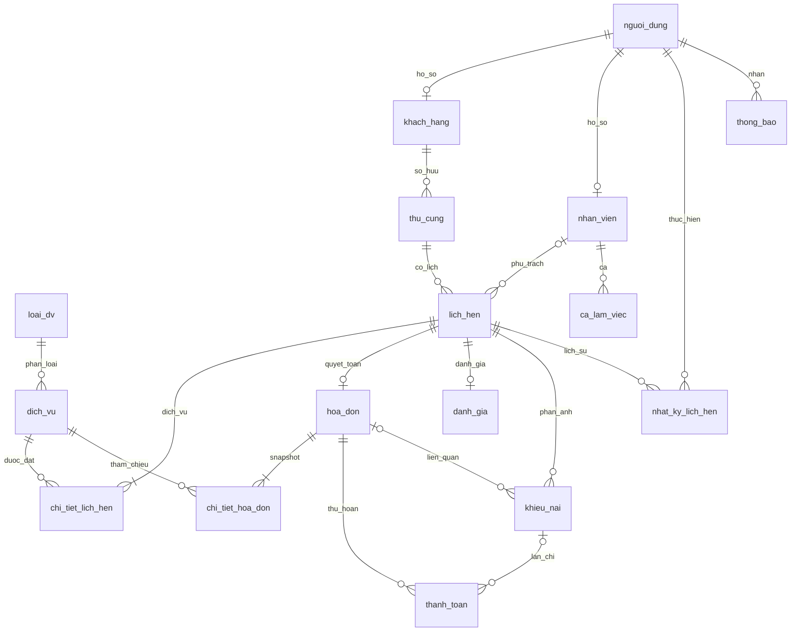

# THIẾT KẾ CƠ SỞ DỮ LIỆU PETCARE

> Cập nhật 24/10/2026 — đã khôi phục đăng nhập: DB development local đã baseline/nâng cấp 002–005 sau backup mới và thử bản sao; dữ liệu/mật khẩu giữ nguyên. Ready và proxy frontend trả 200, hồi quy xác thực 10/10 PASS. Các ghi nhận bên dưới về DB gốc chưa nâng cấp là mốc trước lần sửa này. Chi tiết: [biên bản khôi phục](../docs/DB_LOCAL_RECOVERY.md).

> Phiên bản 3.0, đối chiếu migrations 000–005 và kiểm thử ngày 23–24/10/2026.
> Nguồn: `thu_cung.sql` rồi các file `migrations/001..005` theo thứ tự. Không sửa schema đã có checksum; bổ sung migration mới khi cần.

## 1. Phạm vi và hiện trạng

PostgreSQL 17, extension btree_gist, pg/SQL trực tiếp. Không chuyển ORM hoặc dùng UUID. **16 bảng nghiệp vụ + 1 bảng kỹ thuật** sau migration 003. Identity integer cho khóa chính; `khach_hang`/`nhan_vien` dùng PK đồng thời FK sang `nguoi_dung`. VARCHAR + CHECK cho trạng thái, không phải PostgreSQL ENUM.

DB test mới đã chạy toàn bộ migration/seed. DB local cũ 15 bảng không có lịch sử đã được **backup/restore sang bản sao riêng**, đối chiếu metadata và thử migration 002–005 thành công. Giá trị ở mọi cột nghiệp vụ cũ giữ nguyên qua kiểm tra hash. DB gốc và `.env` chưa đổi; bản sao phục vụ rà soát, không tự thay mục tiêu chạy ứng dụng. Không gọi đây là nâng cấp production.

## 2. Danh sách bảng

| Bảng | Nguồn | Chức năng |
| --- | --- | --- |
| nguoi_dung | 000, bổ sung 002 | Tài khoản, liên hệ, vai trò, token_version, bat_doi_mat_khau |
| khach_hang | 000 | Hồ sơ khách |
| nhan_vien | 000 | Hồ sơ/chức vụ/hoạt động nhân viên |
| thu_cung | 000 | Thú cưng thuộc khách, theo dõi mềm |
| loai_dv | 000 | Nhóm dịch vụ |
| dich_vu | 000 | Danh mục, giá hiện hành, thời lượng, trạng thái bán |
| lich_hen | 000/001/003 | Thú cưng, người phụ trách tùy chọn, bắt đầu/kết thúc, trạng thái, vấn đề chờ lễ tân |
| chi_tiet_lich_hen | 000/001 | Dịch vụ đặt, số lượng, giá dự kiến, tiến độ/ghi chú chăm sóc |
| danh_gia | 000 | Sao/nhận xét, UNIQUE lịch hẹn |
| hoa_don | 000/004/005 | Một hóa đơn/lịch, tổng/giảm/thành tiền, trạng thái, người lập |
| chi_tiet_hoa_don | 000 | Snapshot tên dịch vụ/đơn giá/số lượng/thành tiền |
| thanh_toan | 000/004/005 | Giao dịch thu/hoàn, tiền đưa/thừa, người ghi, chống lặp, liên kết khiếu nại |
| ca_lam_viec | 001/003 | Ca theo ngày/giờ, vị trí/ghi chú, trạng thái hủy mềm |
| khieu_nai | 001/005 | Lịch/hóa đơn, tiếp nhận, quyết định duyệt, thực chi, lỗi chi/chứng từ |
| thong_bao | 001 | Tin trong ứng dụng, người nhận, lịch, đã đọc |
| nhat_ky_lich_hen | 003 | Người thực hiện, hành động, trạng thái cũ/mới, nội dung, thời điểm |
| petcare_schema_migrations | DB tooling | Bảng kỹ thuật version/name/checksum/applied_at |

## 3. Quan hệ chính

Min 1 dòng chi tiết trên sơ đồ là quy tắc tạo ở service, FK không tự bảo đảm hóa đơn/lịch luôn có chi tiết. Chủ khách của lịch hiện suy ra qua thú cưng, chưa hỗ trợ chuyển chủ làm thay đổi lịch sử. Profile cũ được giữ khi đổi vai trò để bảo toàn FK; quyền dựa vào vai trò hiện hành.

## 4. Migration và các cột bổ sung

- **000**: schema gốc 12 bảng, PK/FK/CHECK/UNIQUE.
- **001**: bổ sung ca/khiếu nại/thông báo, thời gian cập nhật, giới hạn nghiệp vụ, trạng thái TuChoi, loại trừ lịch/ca chồng với btree_gist.
- **002**: `nguoi_dung.token_version INT NOT NULL DEFAULT 0`, `bat_doi_mat_khau BOOLEAN NOT NULL DEFAULT false`. Không tự đổi mật khẩu cũ. Tăng version để thu hồi phiên.
- **003**: `ca_lam_viec.trang_thai`, EXCLUDE chỉ ca hoạt động; `lich_hen.yeu_cau_xu_ly`; `nhat_ky_lich_hen` ghi hành động/trạng thái/nội dung với FK người dùng/lịch và index. Không xóa ca hủy.
- **004**: `hoa_don.nguoi_lap`; `thanh_toan.nguoi_ghi_nhan`, `khoa_chong_lap VARCHAR(100) UNIQUE`, `tien_khach_dua/tien_thua NUMERIC(12,2)`; CHECK tiền mặt và index ngày giao dịch. Dòng lịch sử chưa có tiền đưa/thừa có thể để NULL.
- **005**: trạng thái hóa đơn `HoanTienMotPhan`; khiếu nại `ChoHoanTien`, `quyet_dinh`, người/ngày duyệt và chi, bằng chứng/lỗi; `thanh_toan.ma_khieu_nai`. Unique index một giao dịch hoàn **thành công** cho mỗi khiếu nại; cho phép lưu lần chi thất bại. Người tiếp nhận dùng FK người dùng để hỗ trợ Admin theo quyền server, không bắt buộc Admin có profile nhân viên.

Lịch sử migration có checksum SHA-256; tất cả DDL + ghi history cùng transaction/advisory lock. Không sửa SQL 000–005 sau khi đã ghi lịch sử. Existing DB không có history bị CLI từ chối, không tự áp lại schema gốc. Baseline chỉ ghi nhận sau đối chiếu schema; đợt này baseline/thử nâng cấp **chỉ trên bản sao**, không nới guard DB CLI và không sửa DB gốc.

## 5. Trạng thái thống nhất

| Đối tượng | Giá trị |
| --- | --- |
| Lịch | ChoXacNhan, DaXacNhan, DangThucHien, HoanThanh, DaHuy, TuChoi |
| Chi tiết lịch | ChoThucHien, DangThucHien, HoanThanh, DaHuy |
| Hóa đơn | ChuaThanhToan, ThanhToanMotPhan, DaThanhToan, HoanTienMotPhan, DaHoanTien, DaHuy |
| Khiếu nại | DaTiepNhan, ChoHoanTien, DaXuLy |
| Quyết định | TuChoi, KhacPhuc, HoanTien hoặc NULL trước duyệt |
| Phương thức giao dịch | TienMat, ChuyenKhoanQR, HoanTien |
| Giao dịch mới | ThanhCong / ThatBai |

SQL gốc vẫn chấp nhận trạng thái giao dịch cũ `HoanTien`. API mới dùng `phuong_thuc=HoanTien,trang_thai=ThanhCong` cho thực chi thành công; báo cáo gắn cờ số dòng kiểu cũ cần đối soát, không tự diễn giải/đổi lịch sử. Bác bỏ khiếu nại là `quyet_dinh=TuChoi,trang_thai=DaXuLy`, không thêm trạng thái trùng nghĩa.

## 6. Công thức và transaction

- Tổng lịch dự kiến = SUM(số lượng × giá dự kiến); tổng hóa đơn = SUM(thành tiền chi tiết); thành tiền = tổng - giảm, 0 <= giảm <= tổng.
- Đã thu = SUM(giao dịch TienMat/ChuyenKhoanQR, ThanhCong); đã hoàn = SUM(HoanTien, ThanhCong). Công nợ = max(0, thành tiền - đã thu); hoàn không mở lại khoản nợ đã tất toán.
- Mỗi lần thu >0 và <= nợ còn lại. Tiền khách đưa >= ghi nhận; thừa = đưa - ghi nhận. Chụp giá/tên trên hóa đơn; danh mục thay sau không đổi lịch sử.
- Hạn mức duyệt hoàn = đã thu - hoàn thành công - khoản duyệt khác đang chờ chi. Chỉ duyệt hóa đơn đã thu đủ/còn được hoàn. Duyệt giữ chỗ tiền, không ghi thực chi.
- Thực chi thành công mới ghi tiền, người/ngày/chứng từ, đổi trạng thái; chi thất bại giữ chờ và không giảm tiền. Tất cả trong transaction/khóa hóa đơn/khiếu nại, có khóa chống lặp; unique index là lớp bảo vệ bổ sung.
- Công suất xét toàn khoảng với ca hoạt động/người chăm sóc hoạt động. Khóa ngày dùng chung cho đặt/phân công/hủy/đổi lịch/sửa ca/khóa nhân viên; thay nhiều ngày lấy khóa theo thứ tự. Không gộp ca kề nhau.
- Hoàn tất lịch chỉ khi từng chi tiết hoàn thành; vấn đề sức khỏe trước khi làm báo lễ tân, không tự chạy hủy sau nhánh hoàn thành.

CHECK/FK không thay thế toàn bộ quy tắc liên bảng/quyền; service và test đảm bảo các phép tính cùng transaction. Không tuyên bố tự động chuẩn hóa 3NF chỉ dựa số bảng; tổng tiền và snapshot có chủ đích.

## 7. Kiểu thời gian và dữ liệu cũ

Các cột nghiệp vụ hiện dùng TIMESTAMP không timezone, chứa giờ địa phương Việt Nam theo quy ước API. pg Pool mới đặt timezone Asia/Ho_Chi_Minh để NOW() và ngày thu/chi thống nhất; lịch dùng chuỗi ngày/giờ tường minh. DATE ngày sinh giữ nguyên ngày. Không tự cộng/trừ giờ các bản ghi cũ vì chưa biết nguồn ghi ban đầu.

Nếu dữ liệu cũ từng ghi theo timezone khác, cần đối soát timestamp với chứng từ trước khi báo cáo lịch sử. Kiểm thử DB/schema khớp và hash dữ liệu giữ nguyên **không chứng minh** mọi giao dịch cũ đúng nghiệp vụ/đúng timezone.

## 8. Bằng chứng và việc còn lại

Đạt: DB tooling 8, auth/hồ sơ 10, booking 14, dispatch 14, ca/chăm sóc 6, hóa đơn 8, hoàn 8, báo cáo/Admin 7, hành trình 8 trên DB riêng; xem [báo cáo](BAO_CAO_KIEM_THU_HE_THONG.md). Backup cũ restore thành công, so số dòng và hash tất cả cột cũ; đối chiếu columns/constraints/indexes/triggers/functions với schema nguồn roundtrip, rồi migration 002–005 trên copy đạt.

Còn: lựa chọn áp nâng cấp vào môi trường chạy sau khi duyệt kết quả bản sao; không đổi DB production. Docker runtime chưa có; UI tài khoản tạm/CRUD đầy đủ còn QA riêng; VietQR để cấu hình sau. Dump trong `backups/` bị gitignore, báo cáo chi tiết private trong `.cache/local-run/database-audit.json`; không đưa dữ liệu thực hoặc mật khẩu vào Git.

Nguồn: [kế hoạch](ke_hoach_tong_the.md), [schema](../thu_cung.sql), [migrations](../migrations), [DB CLI](../server/scripts/README.md), [API](../docs/API.md), [nhật ký](NHAT_KY_KIEM_TRA.md).

## 9. Bổ sung 25/10/2026 — thanh toán sandbox

Migration mới `006_payment_sandbox.sql` bổ sung bảng `payment_intents`: UUID chuỗi, FK hóa đơn/người tạo/giao dịch; phương thức BankQR/MoMo/COD, mode bắt buộc sandbox, số tiền dương nguyên đồng, trạng thái và thời hạn. Unique partial một yêu cầu Pending/AwaitingCash cho mỗi hóa đơn; event_id và transaction_id UNIQUE. `thanh_toan` thêm phương thức MoMo; COD khi thực nhận ghi TienMat. Tổng đã thu/báo cáo tính cả MoMo; quy trình duyệt và thực chi hoàn giữ nguyên.

000–005 được giữ nguyên checksum. 006 chỉ đã áp dụng trên các DB test mới; không áp dụng DB development/production đang dùng. Readiness chung vẫn yêu cầu 000–005 để không chặn nghiệp vụ cũ; endpoint sandbox kiểm tra bảng riêng và từ chối khi thiếu 006. Mô phỏng bị chặn ngoài NODE_ENV=test + kết nối loopback + tên DB test được opt-in chính xác. Chi tiết nghiệm thu/giới hạn: [Thanh toán sandbox](../docs/THANH_TOAN_SANDBOX.md).
